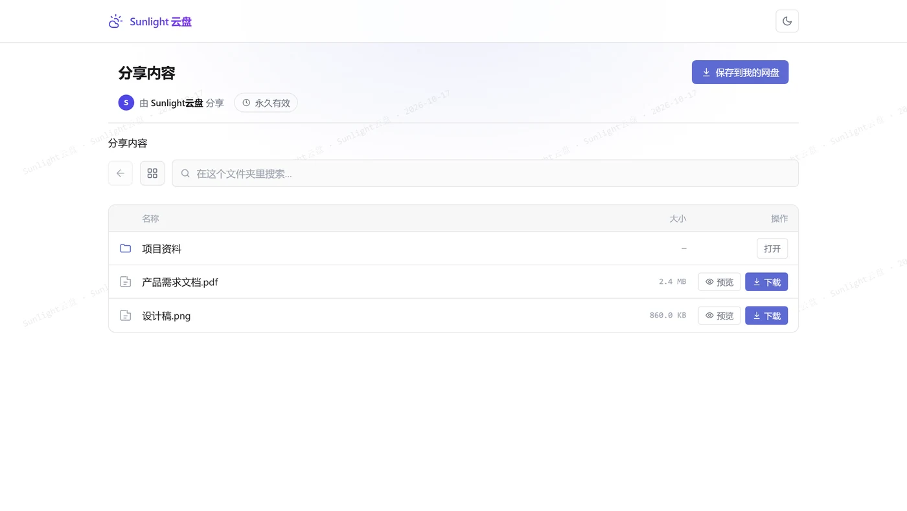
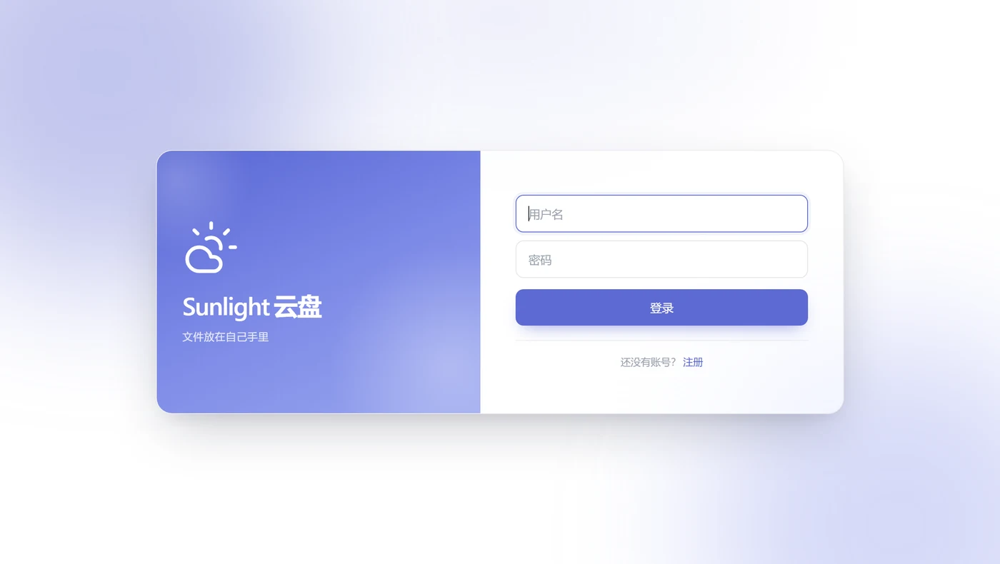
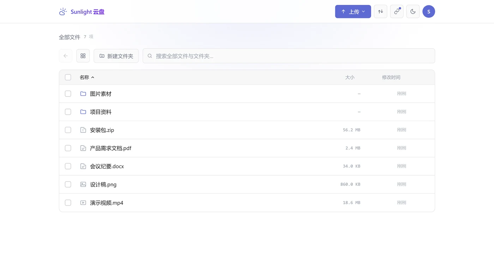
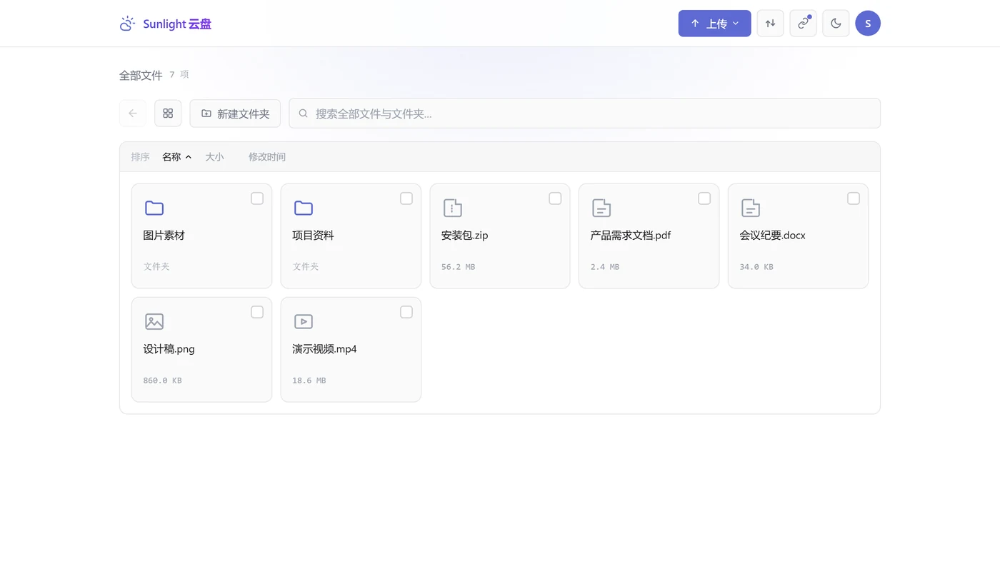
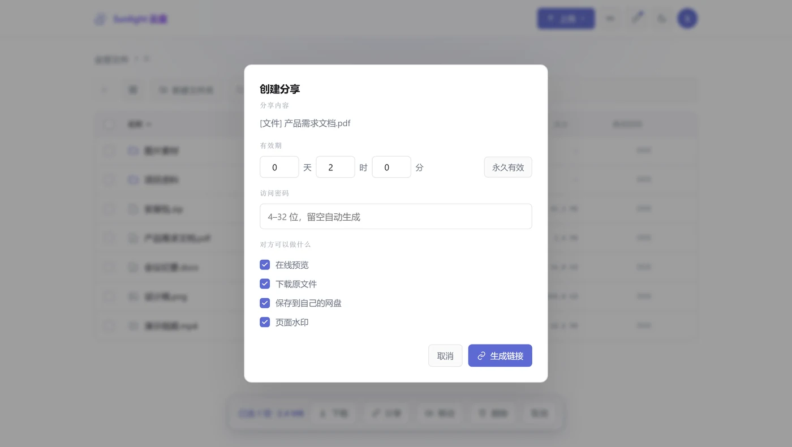
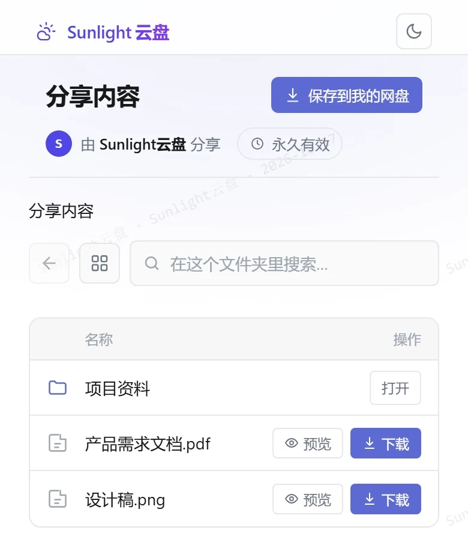
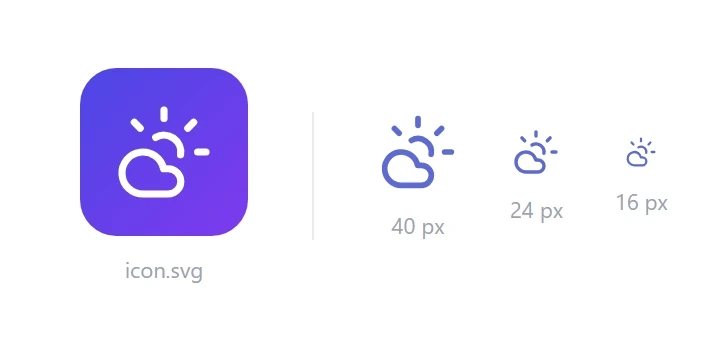

<p align="center">
  
</p>

<p align="center">
  <a href="LICENSE"></a>
  
  
  
  
</p>

浏览器里像用网盘那样管文件，但字节不落在服务器上 ——
上传时浏览器直传对象存储，下载时服务端只签一条短时效链接。
服务器因此永远不是带宽瓶颈，也不持有你的文件内容。

前端**零依赖**（两个 HTML 文件，不含任何外部 JS/CSS）；
后端只依赖 `express` 和 `ali-oss`。



> **想先读设计？** 那份文档讲清了每个取舍背后的理由，以及怎么自己部署：
> [`PROJECT-BOOK.md`](PROJECT-BOOK.md)
> —— 包括架构、数据模型、安全分层、部署步骤、踩过的坑。
> 本 README 只讲"怎么最快跑起来"。

---

## 目录

- [它做什么](#它做什么)
- [界面](#界面)
- [两个设计取舍](#两个设计取舍)
- [快速开始（2 分钟，不需要云账号）](#快速开始2-分钟不需要云账号)
- [接到真实对象存储](#接到真实对象存储)
- [首次启动：谁会成为站长](#首次启动谁会成为站长)
- [部署到服务器](#部署到服务器)
- [配置项](#配置项)
- [项目结构](#项目结构)
- [测试](#测试)
- [安全上的默认值](#安全上的默认值)
- [已知限制](#已知限制)
- [许可](#许可)

---

## 界面

截图来自一个**全新的演示实例**，数据是临时造的例子，不含任何真实文件。

**登录** —— 密码 + 动态码两段式，可选开启。



**文件列表** —— 和登录门同一套视觉。拖动上传、多选、右键菜单都在。



**网格视图** —— 和列表视图随时切换，偏好会记住。



**分享面板** —— 四项权限用勾选控制：在线预览 / 下载原文件 / 保存到自己的网盘 / 页面水印。



下面是**分享页在手机上的样子**（电脑上是同一套排版，见页首大图）——
窄屏会把工具栏收成一行，「大小」列让位给文件名：

<table>
<tr>
<td width="46%" align="center" valign="top">
  <br>
  <sub><b>分享页 · 手机端</b></sub>
</td>
<td width="54%" align="center" valign="top">
  <br>
  <sub><b>品牌标识</b> —— 仓库里提供 <code>assets/icon.svg</code>（渐变方块，用于图标）
  与 <code>assets/logo.svg</code>（单色，16–48px 通用），都是纯矢量、可自由换色。</sub>
</td>
</tr>
</table>

---

## 它做什么

| | |
|---|---|
| **登录** | 密码 + 动态码（标准 TOTP，Google Authenticator 一类 App 扫码即可） |
| **文件** | 无限层级文件夹、新建 / 改名 / 移动 / 删除、全站搜索 |
| **上传** | 拖进页面即可；进度面板、排队、暂停、断点续传 |
| **下载** | 短时效签名链接，字节从对象存储直出 |
| **分享** | 文件与文件夹都能分享，一条链接 + 一个密码；可选有效期或永久 |
| **多用户** | 注册 / 角色（站长、管理员、成员）/ 按人配额 / 停用与恢复 |
| **自带存储** | 用户可绑定**自己的**桶，空间与流量自理，平台方看不到 |
| **界面** | 表格 / 网格双视图、多选与拖拽、亮暗主题、手机浏览器可用 |

---

## 两个设计取舍

这两条决定了整个项目长什么样，值得先说清楚。

### 一、服务器是门卫，不是仓库

```
        ┌──── 上传：浏览器直传（主）────┐
        │                              ▼
用户 ──HTTPS──> 服务器（验身份 / 签凭证） ──> 对象存储（私有桶）
        │                              │
        └──── 下载：只签一条短链 ────────┘
```

- **下载**是花钱的方向（公网出流量计费）→ 让字节绕开服务器
- **上传**字节可以过服务器，但过了就必须加闸（大小上限、文件名消毒、
  落库前核对大小、中断判定）

跨域没配好的时候，上传会**自动回退**到「浏览器 → 服务器 → 对象存储」，
功能不中断，只是会占用服务器带宽。

### 二、归属校验只允许有一个入口

多用户之后，「取一个节点」有三种口径：管理员要能取到任何节点、
分享页要按分享范围取、普通用户只能取自己名下的。

这三种如果压进一个 `get(id, mode)` 里靠参数切换，
**迟早会有人在某条路由上漏传参数**把别人的文件读出去 ——
而且这种漏洞不会报错，只会安静地发生。

所以做成显式视图（[`lib/scope.js`](lib/scope.js)）：

```js
const sc = scope.open(state, userId);   // 拿到的东西天然只属于这个人
sc.get(id)        // 别人的、不存在的，都是 null（越权一律当"不存在"）
sc.parentOf(id)   // 父目录校验和归属校验在同一处做
```

想越权得先绕开这一层，而绕开是有痕的。

---

## 快速开始（2 分钟，不需要云账号）

**不需要对象存储也能跑。** 页面、注册登录、目录管理、分享全都能测；
只有上传和下载会提示未配置存储。

```bash
git clone https://github.com/sunlightsl/sunlight-drive.git
cd sunlight-drive
npm install

node dev.js
```

它会自动做完这些事：

1. 加载 `.env`（没有就不管，直接跑）、检查依赖装没装
2. 先探一遍端口有没有被占用，确认没人听才真正启动
3. 打印配置摘要，以及**当前该走哪条路**

```
============================================================
  Sunlight 云盘 · 本地测试
============================================================
  页面地址    http://127.0.0.1:3000
  站长账号    还没有 —— 打开页面注册第一个账号，它自动成为站长
  访问密码    （未设置：走首次注册）
  双因素      未开启
  OSS         未配置
              页面、登录、新建文件夹、改名、移动、分享都能测
              上传和下载会返回 503（预期行为）
============================================================
```

打开打印的地址，**注册第一个账号** —— 它就是站长（详见
[首次启动：谁会成为站长](#首次启动谁会成为站长)）。

其它参数：

```bash
node dev.js --port 8080          # 换端口
node dev.js --with-password      # 生成站长口令，改用"先定口令"那条路
node dev.js --password           # 只打印当前口令，不起服务
node dev.js --reset-password     # 重新生成口令
```

> **为什么默认不生成口令？** 这个项目的规则是「空库里第一个注册的账号成为站长」。
> 一旦 `.env` 里有 `SITE_PASSWORD`，启动时就会先把站长建出来，
> 之后注册的人只能当普通成员。本地要和线上行为一致，所以默认走注册。

Windows 上也可以直接双击 `run-local.cmd`。

### 开两步验证

```bash
node setup-2fa.js            # 生成密钥 + 打印二维码 + 当场验证一次
node setup-2fa.js --show     # 只看当前密钥和二维码（换手机时用）
node setup-2fa.js --off      # 关掉（只剩密码）
```

扫码用任意标准 TOTP App 都行（6 位、30 秒一换）。

> **同一个动态码不能用两次。** 所以**同一 30 秒窗口内登出后立刻重登会失败** ——
> 这不是 bug，是防重放的必然结果。服务端会把这种情况和"码输错了"分开提示。

也可以**不碰命令行**：登录后在「头像菜单 → 两步验证」里扫码绑定。

---

## 接到真实对象存储

> **这一节里的每一样都是你自己申请的。**
> 本项目**不提供**任何存储桶、AccessKey 或额度，也没有可以共用的公共实例 ——
> 你建的那个桶从头到尾只属于你，仓库里不存在任何真实的凭证或桶名。
> 下文出现的 `<Bucket名>`、`<你的域名>`、`<上传前缀>` 都是占位符，需要换成你自己的。

### 0. 开通对象存储

1. 注册/登录阿里云，进入**对象存储 OSS** 控制台，按提示开通（开通本身不收费）
2. 计费方式是**按量付费**：存储容量 + 外网流出流量 + 请求次数。
   个人使用量级通常每月几元。**建议在「费用中心」设一个可用额度预警**，
   避免被扫桶刷流量
3. 记住你选的 **Region**（如 `oss-cn-hangzhou`），后面填配置要用

### 1. 建一个 Bucket

| 项 | 设置 |
|---|---|
| 读写权限 | **私有**（不要开公共读） |
| 版本控制 | 建议开启 |
| 服务端加密 | 建议开启 |

> **务必确认是"私有"。** 开着公共读时，任何拿到对象地址的人都能直接下载 ——
> 而对象地址是可猜的（前缀 + 用户名 + 年月 + 原名）。
> 验证方法见下面「部署」一节的检查清单。

### 2. 建一个最小权限的子账号

**不要用主账号的 AccessKey。** 建一个 RAM 子账号，策略里把读写范围分开：

```json
{
  "Version": "1",
  "Statement": [
    {
      "Effect": "Allow",
      "Action": ["oss:GetObject", "oss:GetObjectMeta"],
      "Resource": ["acs:oss:*:*:<Bucket名>/<上传前缀>/*"]
    },
    {
      "Effect": "Allow",
      "Action": ["oss:PutObject", "oss:DeleteObject"],
      "Resource": ["acs:oss:*:*:<Bucket名>/<上传前缀>/*"]
    }
  ]
}
```

分片直传还需要 Multipart 系列动作与 `ListParts` / `ListMultipartUploads` /
`AbortMultipartUpload`，少了会报 `AccessDenied`。

### 3. 配跨域（浏览器直传必需）

Bucket → 数据安全 → 跨域设置：

| 项 | 值 |
|---|---|
| 来源 | `https://<你的域名>`（**不要写 `*`**） |
| 允许 Methods | `GET, POST, PUT, HEAD, DELETE` |
| 允许 Headers | `*` |
| **暴露 Headers** | **`ETag`, `x-oss-request-id`** |
| 缓存时间 | `600` |

> **`ETag` 必须在「暴露 Headers」里。**
> 放到「允许 Headers」那一栏，分片能传上去但浏览器读不到 ETag，会被当成失败 ——
> 而报错只说「部分分片上传失败」，完全指不到跨域上。
>
> 不配跨域也能用（会自动回退到经服务器中转），但**大文件走中转会比较慢**。

### 4. 填配置

两种方式，任选：

**a) 页面里填**（推荐，密钥加密落盘）
启动后登录站长账号 →「头像菜单 → 配置」→ 填入 Region / Bucket / AccessKey →
点「保存并测试连接」。**测试通过才会落盘。**

**b) 写进 `.env`**
把 `.env.example` 复制成 `.env`，填 `OSS_REGION` / `OSS_KEY_ID` /
`OSS_KEY_SECRET` / `OSS_BUCKET`。

两种方式同时存在时，**页面配置优先**。

---

## 首次启动：谁会成为站长

站长（owner）能进用户管理、改配额、停用账号。**它只会产生一个，就在空库的时候。**

### 推荐做法：先定好口令再启动

在 `.env` 里设一个 `SITE_PASSWORD`，然后启动服务。

```
SITE_PASSWORD=<一个足够长的随机口令>
ADMIN_USERNAME=sunlight          # 可选，站长账号名，默认 sunlight
```

首次启动时程序会用这个口令建出站长账号，**之后这个环境变量就失效了**
（库里已经有账号，不再走这段逻辑）。用它登录，再按需开两步验证、改密码。

> 这是**确定性**的做法 —— 启动那一刻站长就已经存在，不存在被人抢注的窗口。

### 另一种做法：让第一个注册的人成为站长

不设 `SITE_PASSWORD`、且 `REGISTRATION=open` 时，**空库里第一个通过注册创建
的账号会自动成为站长**（同时拿到 `pro` 计划，不受默认配额限制）。
之后注册的人一律是普通成员。

> ⚠️ **这条路有抢注窗口。** 从服务启动到你注册之间，任何先来注册的人都会成为站长。
> 所以要么**先在本机跑通再开放公网**，要么干脆用上面那种做法。
> 公网服务器上裸露着开放注册又不设 `SITE_PASSWORD`，等于把管理权送人。

### 两种做法都会遇到的坑

- **`REGISTRATION=closed` 且没有 `SITE_PASSWORD`** → 启动后一个账号都没有，
  而且注册被关掉了，**任何人都登录不进来**。这种组合等于自锁。
- 忘了口令？停服务，删掉 `data/drive.json` 就回到「空库」状态（**这会丢全部文件结构**），
  或者手工改 `data/drive.json` 里的账号记录。
- 站长的配额不受限制，`plan` 是 `pro`；普通用户受 `QUOTA_GB` 约束。

---

## 部署到服务器

`PROJECT-BOOK.md` 的 §10–§13 是完整步骤（含 Nginx 配置、systemd 单元、
证书签发、验证清单）。这里只列**最容易漏、且漏了很难查**的四条：

**1. Nginx 要放宽上传限制** —— 默认 1MB 会把大文件挡掉，
而且报的错和真实原因没关系：

```nginx
client_max_body_size 2048m;    # 要和 MAX_UPLOAD_MB 对齐
proxy_request_buffering off;   # 边收边转，不先落盘
proxy_read_timeout 1800s;
```

**2. `X-Forwarded-For` 必须设**，否则限流会把所有访问者当成同一个 IP：

```nginx
proxy_set_header X-Forwarded-For $proxy_add_x_forwarded_for;
```

同时把 `.env` 里的 `TRUST_PROXY` 设为 `1`。
**没有反向代理时它是 0** —— 设为 1 而没有反代 = 任何人都能伪造这个头绕过限流。

**3. 证书用 webroot，不要用 standalone。**
standalone 续期要独占 80 端口，而 Nginx 占着它，
结果是**每 60 天自动续期必然失败**，直到证书过期才发现。

```bash
certbot certonly --webroot -w /var/www/certbot -d <你的域名>
```

**4. 服务要 `enable`，不能只 `start`**：

```bash
systemctl enable --now sunlight-drive
```

### 上线后的检查清单

```bash
BASE=https://<你的域名>

# 匿名访问必须被拒（期望 401）
for p in /api/tree /api/shares /api/account; do
  printf '%-16s -> %s\n' "$p" "$(curl -s -o /dev/null -w '%{http_code}' $BASE$p)"
done

# 源码与配置不可下载（期望 404）
for p in /server.js /.env /package.json /lib/auth.js; do
  printf '%-16s -> %s\n' "$p" "$(curl -s -o /dev/null -w '%{http_code}' $BASE$p)"
done

# 存储桶必须是私有的（三条都期望 403）
curl -s -o /dev/null -w '匿名读对象 -> %{http_code}\n' \
  'https://<bucket>.<region>.aliyuncs.com/<一个真实的对象 key>'
curl -s -o /dev/null -w '匿名列目录 -> %{http_code}\n' \
  'https://<bucket>.<region>.aliyuncs.com/?list-type=2'
curl -s -o /dev/null -w '匿名写对象 -> %{http_code}\n' -X PUT --data x \
  'https://<bucket>.<region>.aliyuncs.com/probe.txt'
```

功能上还要实测一遍：**传一个 >16MB 的文件**（这条走分片）、
**分享一条并用无痕窗口打开**、**手动改分享链接里的 `?parent=` 参数确认返回 403**。

---

## 配置项

完整清单见 [`.env.example`](.env.example)（每项都有注释）。几个关键的：

| 变量 | 默认 | 说明 |
|---|---|---|
| `PORT` | `3000` | 监听端口 |
| `SITE_PASSWORD` | （空） | 首次启动用它建站长账号，**之后失效**。见「谁会成为站长」 |
| `ADMIN_USERNAME` | `sunlight` | 上面那条路用的账号名 |
| `REGISTRATION` | `open` | `closed` 只允许已有账号登录。**面向公网建议 `closed`** |
| `DRIVE_DATA_DIR` | `./data` | 数据目录（`drive.json` / `secrets.json` / `.master.key`） |
| `TRUST_PROXY` | `0` | 仅在反向代理之后才设 `1` |
| `MAX_UPLOAD_MB` | `2048` | 单文件上限，要和 Nginx 对齐 |
| `QUOTA_GB` | `1` | 用平台存储的用户的默认配额，`0` = 不限 |
| `SHARE_TTL` | `7200` | 分享默认有效期（秒） |
| `SIGN_TTL` | `300` | 下载链接有效期（秒） |
| `TZ` | — | 时区。Linux / macOS 生效，**Windows 不认**（那边改系统时区） |
| `TOTP_DISABLED` | `0` | **别在公网服务器上设成 1** |

> **关于 `MASTER_KEY`**：它加密存储凭证与分享密码原文。
> 默认**不用设** —— 程序会自动生成 `data/.master.key`（权限 600）。
> 注意它的语义是**口令**（内容会被哈希），而密钥文件里是**原始 32 字节**，
> 所以把密钥文件的内容填进 `MASTER_KEY` **永远解不开已有密文**。
> 两套来源不可混用，详见项目书。

---

## 项目结构

```
server.js            后端全部路由
index.html           主界面（单文件，样式与逻辑都在里面）
share.html           分享访问页
lib/                 拆出来的纯逻辑，每个文件只回答一个问题
  ├─ config.js       所有环境变量只在这里读一次
  ├─ store.js        drive.json 的读写：原子写 + 写操作串行化
  ├─ tree.js         纯函数式树操作 + 越权判定 + 环检测
  ├─ scope.js        按用户切一刀的文件树视图
  ├─ users.js        账号：注册、角色、配额、停用
  ├─ auth.js         登录、会话、限流、两段式票据
  ├─ secret.js       密码哈希与常量时间比较
  ├─ totp.js         动态码（RFC 6238），含容差与防重放
  ├─ ossconfig.js    存储配置：加密落盘、连接测试、签名
  ├─ reqguard.js     判断上传是不是中途断了
  └─ qrcode.js       二维码（自己画 SVG，不引第三方）
test/                零依赖测试
PROJECT-BOOK.md      设计、理念、部署、踩坑记录
```

运行时数据在 `data/`（已被 `.gitignore` 挡住）：

| 文件 | 作用 |
|---|---|
| `drive.json` | 目录结构与分享记录，**唯一真相** |
| `drive.json.bak` | 上一次的副本 |
| `secrets.json` | 加密后的存储凭证 |
| `.master.key` | 解密用的主密钥 |

> **备份必须成对**：`drive.json` 只记录结构，**不含文件内容**；
> 而 `.master.key` 和 `secrets.json` 是一套的，缺一个就解不开。
> 完整备份 = 结构数据 + 对象存储上的内容。

---

## 测试

```bash
npm test          # 11 个套件：纯逻辑、配置、签名、账号、分享、预览、
                  # 错误处理、首次部署、启动器、数据目录、端到端
npm run test:ui   # 5 个套件：浏览器行为（需要本机有 Edge/Chrome，没有会跳过）
```

全部**零依赖**，不需要装测试框架，也不需要对象存储 ——
测试自带假的 OSS 客户端，并且会刻复真实限制（比如"不允许在签名时覆盖 content-type"）。

| 套件 | 覆盖什么 |
|---|---|
| `test/run.js` | 纯逻辑：文件名消毒、树操作、环检测、越权判定、TOTP（用 RFC 6238 官方向量）、密码哈希、常量时间比较、二维码、上传中断判定 |
| `test/oss-config.js` | 存储配置模块：加密落盘、脱敏、多用户解析优先级 |
| `test/multipart.js` | 分片上传的 URL 签名（按官方规范另写一份实现做交叉验证） |
| `test/account-state.js` | 账号状态：停用立刻生效、恢复、强制下线、防呆、权限边界，以及停用时撤销分享 |
| `test/session-cookie.js` | 会话 cookie 的属性、仅凭 cookie 的认证路径、分享票据交换 |
| `test/share-save.js` | 分享转存：四类权限（预览/下载/转存/水印）的放行与拦截、改名冲突、限流、回滚 |
| `test/preview.js` | 在线预览：签名参数、白名单边界（svg/html 绝不 inline）、假 OSS 客户端复刻真实限制 |
| `test/error-handler.js` | 兜底错误处理：畸形请求体不回显堆栈、413 而不是 500、正常错误不被吞 |
| `test/first-owner.js` | 首次部署：四种组合下谁成为站长，含「注册关闭 + 无口令」的自锁场景 |
| `test/dev-js.js` | 本地启动器：默认不生成口令、`--with-password` 才生成、不覆盖已有 `.gitignore` |
| `test/data-dir.js` | `DRIVE_DATA_DIR` 的路径解析：空值/空格值回落到 `./data`，绝对路径按其生效 |
| `test/e2e.js` | 接口串起来的行为：登录限流、静态白名单、树操作、分享与越权、双因素第一步 |
| `test/refresh-recover.js` | 用 CDP 驱动真实浏览器：刷新页面后未完成的传输能不能找回来、重选文件是续传还是重传 |
| `test/share-view.js` | 分享页交互：类型图标渲染、点文件夹进出、双击语义、返回按钮、视图切换、搜索 |
| `test/share-align.js` | 列对齐：表头与各行的右边缘、操作列宽度不随内容变、窄屏不横向溢出 |
| `test/share-mobile.js` | 窄屏布局：标题与转存按钮同行、长标题不撑破、大小列按预期隐藏 |
| `test/admin-quota.js` | 用户管理的配额控件：输入框不被挤扁、三种来源标记、窄屏不溢出 |

另有几个**手动**脚本（不在 `npm test` 里，需要真机或真实 OSS）：

| 脚本 | 用途 |
|---|---|
| `test/direct-upload.js` | 直传/分片/分享的端到端检查，需要先起一个隔离实例 |
| `test/qa-*.js` | 界面视觉与交互验证（CDP 驱动系统 Edge），可选用 |

界面测试用 Node 内置的 WebSocket 连浏览器调试端口，
所以不需要 `puppeteer` 之类的东西。

> 测试里有一条值得单独说：**`req.on('close')` 不能用来判断上传中断**。
> 正常上传和中断都会触发 `close`，用它判中断会让**每一次成功上传都被误杀**。
> `test/run.js` 里起真 HTTP 服务，两种场景各跑一遍钉住这个行为。

---

## 安全上的默认值

| 面 | 做法 |
|---|---|
| **越权** | 一律返回"不存在"，不回 403（403 等于确认这个 id 存在但不归你） |
| **分享** | 每次列目录和下载都重新校验目标在分享范围内 —— 改 URL 参数无效 |
| **密码** | scrypt 慢哈希 + 常量时间比较；用户不存在时也走一次哈希，避免用户名枚举 |
| **动态码** | 两段式登录（密码换票据、动态码换会话），第二段独立限流 |
| **静态文件** | **白名单**：只放行固定几个路径，其余一律 404 |
| **凭证** | 支持加密落盘（AES-256-GCM），接口只回脱敏值 |
| **限流** | 按 IP 计窗口内失败次数，锁定期内正确密码也拒绝 |

白名单而不是黑名单的原因：静态目录直出**不走任何鉴权**，
黑名单永远列不全（将来加个 `.bak`、编辑器临时文件就漏了）。

---

## 已知限制

照实列出来，用之前应该知道：

- **中文文档**。界面和文档目前都是中文，暂无英文版。
- **单实例**。会话存在内存里，重启后需要重新登录；
  多实例部署需要把会话和数据结构换成共享组件。
- **配额可被并发绕过**。配额在写字节之前检查，而"已用空间"按文件树实时聚合 ——
  同一账号并发上传时每个请求都会看到同一个"已用"，可以短暂超出。
  单文件上限仍然有效。
- **小文件没有断点续传**。小于阈值的文件走一次性上传，协议上没有"部分"的概念，
  刷新后只能重传（界面会明确区分这两种状态）。
- **自带桶的孤儿分片不会被回收**。定时回收任务只扫平台自己的桶，
  用户自己桶里中断的分片需要他自行清理。
- **登录限流按 IP 计**，在 NAT 后面会误伤同网用户。

详见项目书 §15。

---

## 许可

[MIT](LICENSE)。
